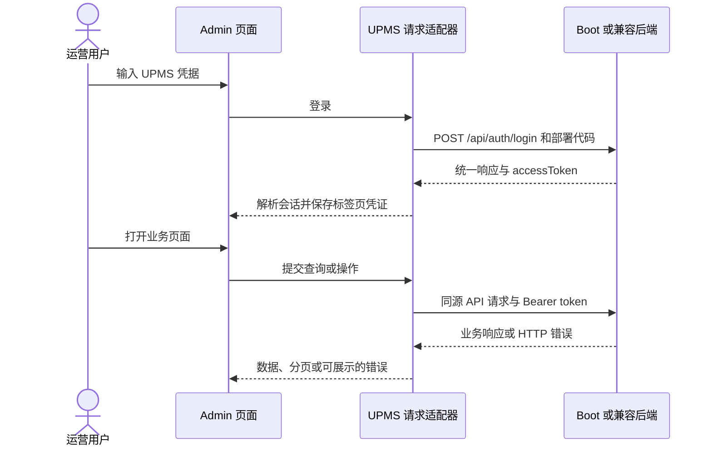

# LoadUp Admin 架构

## 页面与路由

Vite 构建 React 应用。`src/router/index.tsx` 读取 `src/views` 中的 `*.router.tsx`，注册页面与菜单元数据。登录和注册路由独立挂载，受保护路由使用 `ProtectedRoute` 检查会话、管理角色或业务菜单授权。模块内按需懒加载页面，公共布局由 `App.tsx` 与布局组件提供。Zustand 分别保存用户会话和界面设置。

登录后，普通账号读取 UPMS 的当前用户菜单树，超级管理员读取权限树中的启用且可见菜单。Admin 以本地注册路由匹配菜单的资源路径，同一份可访问路径集合用于侧栏和直达路由。个人中心向所有登录账号开放，系统管理由超级管理员访问。应用接口权限及数据范围在服务端校验。

## 登录与业务请求

`src/utils/upms.ts` 读取令牌声明供界面展示和路由使用，以 `sessionStorage` 保存当前标签页 access token。后端安全链负责令牌验证、权限判断与所有者过滤。请求适配器统一传递 `X-Tenant-Code`，从业务响应中提取 `result`、`data` 与 `pageInfo`。下载通过业务请求工具处理二进制响应。

## 业务边界

- 工作台查询当前用户的 Inbox 和 Transfer 摘要。通知铃铛与收件箱共用通知工具及变更刷新逻辑。
- 表单编辑器以实例绑定的发布定义为输入，草稿保存和提交由后端校验，发布后的字段布局来自服务端快照。
- 审批页面负责模板、发起、待办与详情。流程图、审批资格和状态迁移以 Approval 返回的模型为准。
- UPMS 与其他管理页面通过各业务 API 持久化。原模板示例源码保留在 `src/views`，路由扫描排除 customers、dashboard、profile 和 team。

## 运行拓扑

开发时 Vite 代理同源 `/api`。部署时静态站点与 API 由网关或托管平台组合，业务 API 路由优先于前端导航回退。生产环境的地址、认证与部署代码按宿主设置对齐。

[启动与接入](README.md) · [Boot 架构](../loadup-boot/ARCHITECTURE.md)
